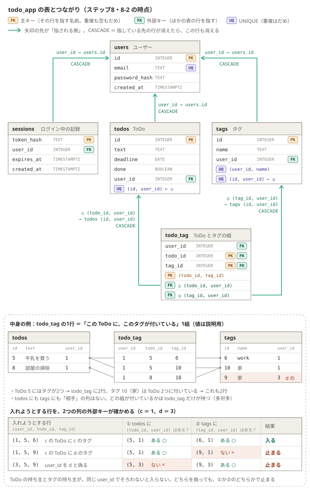
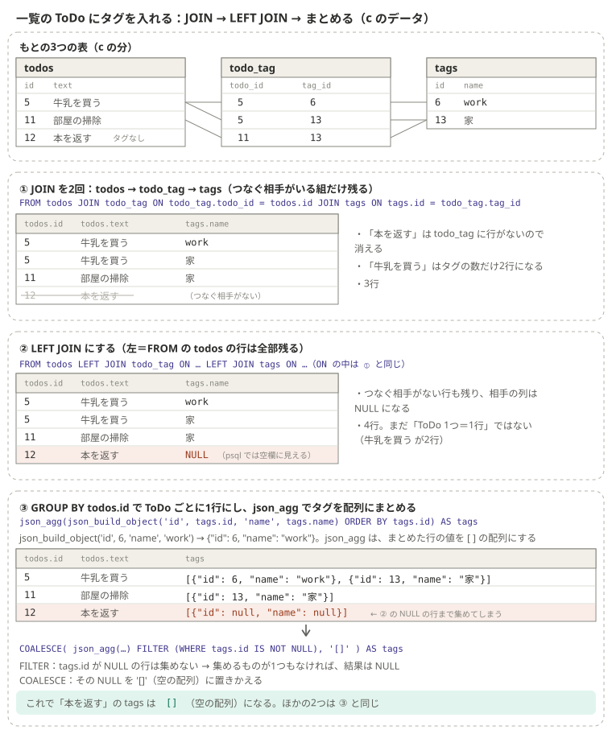

# ステップ8：タグ（Issue #1）（まとめ）

期間: 2026-10-28〜11-01
ゴール: ToDo に複数のタグを付け、状態・タグ・キーワード・並び順を組み合わせて一覧を絞り込める。PR を出してメンターのレビューを受ける → 一部達成（8-1〜8-4 のタグの表と API まで。8-5 絞り込みと検索・8-6 画面・8-7 PR は飛ばした。D-0031、D-0032。タグはステップ9 で Drizzle に移して残した。D-0033）
ブランチ: `feature/1-tags-search`（`main` から。PR は出さず、GitHub に残す）

早見表（紹介しただけで使っていない知識も含む）
- 多対多と中間の表・組の主キー・2つの列の外部キー・`ON DELETE`・消したときに起きること（表の図つき）：[reference/database.md](../reference/database.md)
- `JOIN` から `LEFT JOIN`・`GROUP BY`・`json_agg`・`FILTER`・`COALESCE` まで（図つき）：[reference/database.md](../reference/database.md)
- `server.ts` の流れと、画面の関数と API の図（8-3 の時点）：[reference/server.md](../reference/server.md)

---

## 全体の流れ



```
多対多は中間の表で持つ。todo_tag の1行 ＝「この ToDo に、このタグが付いている」1組

tags      id・name・user_id。UNIQUE (user_id, name) で、同じ人は同じ名前のタグを2つ作れない
todo_tag  user_id・todo_id・tag_id。主キーは組 (todo_id, tag_id)（同じタグは2回付かない）
          (todo_id, user_id) → todos (id, user_id)、(tag_id, user_id) → tags (id, user_id)
          → ToDo とタグの持ち主がそろわないと入らない（他人のタグは DB でも止まる）
          指される側に UNIQUE が要るので、todos と tags に UNIQUE (id, user_id)
消すとき  外部キーはすべて ON DELETE CASCADE。タグを消すと todo_tag の行だけ消え、ToDo は残る
```



```
一覧の ToDo にタグを入れる（1つの SQL）
todos LEFT JOIN todo_tag LEFT JOIN tags   ToDo × タグの行。タグなしの ToDo も残る（相手の列は NULL）
→ GROUP BY todos.id                       ToDo ごとに1行
→ json_agg(json_build_object(...))        タグを [{ id, name }, ...] の配列に（pg は JS の配列にして渡す）
→ FILTER (WHERE tags.id IS NOT NULL)      NULL の行は集めない（1つもなければ NULL）
→ COALESCE(..., '[]')                     NULL なら []
```

## 作ったもの

```
app/（ブランチ feature/1-tags-search）
├── db/schema.sql         tags（UNIQUE (user_id, name)・UNIQUE (id, user_id)）、
│                         todo_tag（組の主キー、2つの列の外部キーを2つ）、todos に UNIQUE (id, user_id)
└── src/server/server.ts  タグの API 3つ、一覧の ToDo にタグ、付け外しの API 2つ、ToDo を作るときの tagIds（トランザクション）
（画面の main.ts は変えていない。8-6 は飛ばした）
```

```
server.ts の形（8-4 の時点）

app.use("/api/tags", requireLogin)
GET    /api/tags                   SELECT id, name ... WHERE user_id = $1 ORDER BY id（作った順）→ 200
POST   /api/tags                   typeof → trim().toLowerCase() → 空・21文字以上なら 400
                                   → INSERT ... ON CONFLICT (name, user_id) DO NOTHING RETURNING id, name → rowCount 0 で 409 / 201
DELETE /api/tags/:id               DELETE ... WHERE id = $1 AND user_id = $2 → rowCount 0 で 404 / 204
GET    /api/todos                  LEFT JOIN 2回 → GROUP BY todos.id → COALESCE(json_agg(...) FILTER (...), '[]') AS tags
POST   /api/todos/:id/tags/:tagId  確認の SELECT（todos JOIN tags ON 持ち主が同じ。自分・:id・:tagId で絞る）→ 0行で 404
                                   → INSERT ... ON CONFLICT (todo_id, tag_id) DO NOTHING → 204（もう付いていても 204）
DELETE /api/todos/:id/tags/:tagId  DELETE ... WHERE user_id AND todo_id AND tag_id → 0行で 404 / 204
POST   /api/todos                  tagIds ?? [] → 整数の配列でなければ 400（Array.isArray・every・Number.isInteger）
                                   → 下のトランザクション → 201 { id, text, deadline, done, tags }
```

```
ToDo とタグを一緒に作る（トランザクション＝全部か無か）

pool.connect() で接続を1本借りる（pool.query は毎回別の接続を使うことがある。BEGIN〜COMMIT は同じ接続で送る）
BEGIN → todos に1行 → タグごとに：確認の SELECT → todo_tag に1行（ON CONFLICT DO NOTHING）→ COMMIT（全部そろって確定）
        自分のタグでなければ ROLLBACK → 400（todos の1行も取り消す。id の番号は戻らず欠番になる）
catch で ROLLBACK して throw（500）、finally で release()（接続をプールに返す）
```

### このステップで決めたこと
| 内容 | 却下した案 | 決定 |
|---|---|---|
| タグは `tags` と中間の表 `todo_tag` で持つ。中間の表の主キーは組 `(todo_id, tag_id)` | `todos` に文字列の列・配列の列（同じ名前や他人のタグを DB で止められない）、中間の表に自分の `id` 列＋`UNIQUE` | D-0026（学習者） |
| 他人のタグ・ToDo は、`todo_tag.user_id` と2つの列の外部キーで DB でも止める | 中間の表の `user_id` を消し、アプリの SQL だけで確かめる | D-0026（学習者） |
| タグを消すと ToDo から外れるだけ（`ON DELETE CASCADE`） | 付いているあいだは消せない（`RESTRICT`）、論理削除、ToDo ごと消す | D-0026（学習者） |
| タグの名前の大文字・小文字は、サーバーで小文字にそろえる | DB の `lower(name)` の `UNIQUE` 索引 | D-0026（学習者） |
| タグの API は作る・一覧（作った順）・消すの3つ。1〜20文字、同じ名前は 409、返す形に `user_id` を入れない | 名前順（漢字は読みの順にならない）、名前の変更（Issue にない） | D-0010 |
| 一覧のタグは1つの SQL（`LEFT JOIN` 2回・`GROUP BY`・`json_agg`） | 2回の SELECT を TS でまとめる（8-5 の絞り込みを1つの `WHERE` に足せない） | D-0010 |
| 付け外しは、確認の SELECT → `ON CONFLICT DO NOTHING` → 204 | 外部キーのエラー（23503）を try/catch で 404 にする（他人の「もう付いている組」で 204 になる穴） | D-0010 |
| `tagIds` は `pool.connect()` と BEGIN・COMMIT・ROLLBACK。自分のタグでなければ 400（ID が本文にあるので 404 ではない） | 外部キーのエラーを拾う（エラーコードと `DatabaseError` が増える） | D-0010 |
| 新しい書き方は説明（図）→ 実装。予想のクイズは出さず、確かめ方には期待する結果を添える | 予想の問いを続ける | D-0027 |
| 課題は top-down（完成形 → 必要な要素 → 今やること）。図はチャットの中に出す | 小さな手順から積み上げる | D-0028 |
| 8-5（絞り込みと検索）は飛ばす。ステップ9〜12 は Issue #4〜#7 | 8-5〜8-7 までやる（時間がない） | D-0031 |
| 8-4 で終え、PR は出さずブランチを残す | タグの作業を PR にして `main` に入れる（#4〜#7 はタグのない `main` が前提） | D-0032 |

---

## つまずいたことと解決方法
| つまずき | 原因 | 解決 |
|---|---|---|
| `tags` の主キーを `tag_id`、外部キーを `id` と書いた | 自分の番号の列と、ほかの表を指す列の混同 | `users.id` と `todos.user_id` で比べる。自分の番号は `id`、指す列は `表名_id` |
| `name` に `NOT NULL` がない | `UNIQUE` は `NULL` 同士を別物として扱う | `NOT NULL` を足す。そうしないと名前なしのタグがいくつでも入る |
| 組の主キーを `UNIQUE` で書いた | 主キーと `UNIQUE` の違い | `PRIMARY KEY (todo_id, tag_id)`（空も重複もだめ） |
| `todo_tag.user_id` が何も確かめていない | 列を置いただけで、外部キーにつながっていない | `FOREIGN KEY (todo_id, user_id) REFERENCES todos (id, user_id)` と tags 側も |
| `there is no unique constraint matching given keys for referenced table "todos"` | 指される側の組に `UNIQUE` がない | `todos` と `tags` に `UNIQUE (id, user_id)` |
| タグつきの ToDo・タグ・ユーザーが消せない | 1つの列の `REFERENCES ... ON DELETE CASCADE` を外したとき、`CASCADE` を移し忘れた（`NO ACTION` になる） | 2つの列の外部キーにも `ON DELETE CASCADE` |
| 試しのデータの INSERT が丸ごと止まった | d が id 3 だった（登録の INSERT が1回失敗して2番を使った）。Claude の手順が 2 と決め打ちしていた | 1つの INSERT は全部か無か。id は決め打ちせず `RETURNING` で確かめる |
| 8-4 A の課題が「話が長くてわからなかった」 | ⓪〜④ と Q1〜Q3 を一度に出した。知らないことの予想は疲れる | 図（`join-steps.svg`）で説明 → 実装（D-0027）。完成形から示す（D-0028） |
| `PREPARE` で止まった：関数がない・列が「あいまい」 | `json_build_objet` のつづり。`user_id` は `todos`・`todo_tag`・`tags` の3つにある | `todos.user_id` のように表名をつける |
| `git add db/schema.sql` で `pathspec` のエラー | 外側のフォルダで実行した | `cd app` してから。`pwd` で確かめる |
| `PREPARE` で止まった：`usser_id`、`INSERT FROM`、`todo_tags` | つづり | `PREPARE` で実行せずに確かめる。表名・列名は `schema.sql` と見比べる |
| 他人の ToDo に自分のタグを付けられる穴 | 確認の SELECT に「持ち主が自分」（`todos.user_id = $1`）がない | 持ち主が同じ組だけをつなぎ、さらに自分で絞る |
| curl が返事を待ち続ける | `res.status(204)` だけで `.end()` がない | 返事を送るのは `.end()`・`.json()`。`status` は番号を決めるだけ |
| 見つからないときに 400 | ステータスの意味 | URL の `:id` が見つからなければ 404 |
| `pool.query<number>` で `TS2344` | `<...>` は1行の形（オブジェクト） | `<{ id: number }>`。結果を使わないなら付けない |
| 自分のタグでないときの 400 で ROLLBACK がない | `return` する前に取り消していない | BEGIN の途中の接続がプールに戻り、次にその接続を使う GET に作りかけの ToDo が見え、次の COMMIT で確定してしまう。`ROLLBACK` してから 400 |

## 理解度チェック（2026-10-28、11-01）
| 日付 | 質問 | 結果 |
|---|---|---|
| 10-28 | `todos` に `tag_id` の列を1つ足すのではだめな理由と、中間の表の1行が表すもの | 「複数のタグを付けられない」は答えられた。中間の表の1行＝「この ToDo にこのタグが付いている」1組、が抜けた |
| 10-28 | c が DB に直接、自分の ToDo に d のタグを付けたら何が止めるか（`user_id` を d と偽っても止まる理由） | 「DB の references でエラー」は方向は合っている。2つの列の外部キーが `tags` に `(9, 1)` を探して見つからない仕組み、偽ると `(5, 3)` が `todos` にない、が答えられず（要復習）。8-4 の始めに図で確かめ直して正解 |
| 10-28 | タグを消したとき ToDo が残り中間の表の行だけ消えるのはどこで決めているか、`ON DELETE` を書かないと何が起きるか | 「`todo_tag` の行は残り、tags だけ消える」と回答 → 誤り。`todo_tag` の外部キーの `ON DELETE CASCADE` で決めている。書かないと `NO ACTION` でタグの削除が止まる（要復習）。8-4 の始めに確かめ直して、動きは正解（`ON DELETE CASCADE` の名前は補足） |
| 11-01 | ROLLBACK で何が戻り、何が戻らないか | 「足した行は元に戻る」は正解。戻らないもの＝id の番号（欠番になる）が答えられず（要復習） |
| 11-01 | `pool.query` ではなく `pool.connect()` の `client` を使う理由 | 「ROLLBACK できるように」まで。`pool.query` は毎回別の接続を使うことがあり、BEGIN〜COMMIT を同じ接続で送らないとトランザクションにならない、が抜けた（要復習） |
| 11-01 | 付け外しで「外部キーのエラーを 404 にする」案を採らなかった理由 | 答えられず（要復習）。他人の「もう付いている組」では `ON CONFLICT` が先に効いて何もせず終わり、外部キーの確認まで進まないので 204 になる |

## 要復習
- 中間の表の1行＝「この ToDo にこのタグが付いている」1組（10-28 Q1）
- 2つの列の外部キー：`(tag_id, user_id)` が `tags` に、`(todo_id, user_id)` が `todos` にあるかを確かめる。`user_id` を偽っても、どちらかで止まる（10-28 Q2。確かめ直しで答えられた）
- `ON DELETE CASCADE` は「指している側」の行を消す。書かないと `NO ACTION` で、指されている行を消す方が止まる（10-28 Q3。確かめ直しで動きは答えられた）
- ROLLBACK しても id の番号は戻らない（欠番）（11-01 Q1）
- トランザクションは同じ接続で送る。だから `pool.connect()`（11-01 Q2）
- `ON CONFLICT` は外部キーより先に効く（11-01 Q3）
- ステップ7から持ち越し：認証と認可、Cookie に `userId` を入れない理由、合言葉がソルトなしでよい理由、`SameSite=Lax`
- ステップ6から持ち越し：`""` と `null` の違い、`tsc` は「検証して変換」、目的の違う変更はコミットを分ける、`flex-basis: 100%`
