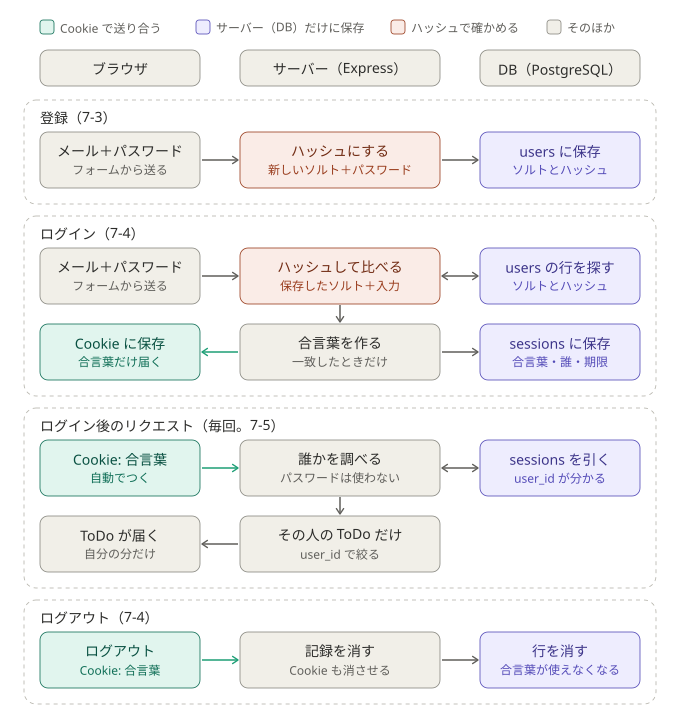

# ログイン（認証）（早見表）

作成: 2026-10-27（ステップ7）
詳しく調べるとき: [MDN: HTTP Cookie](https://developer.mozilla.org/ja/docs/Web/HTTP/Guides/Cookies)、[OWASP: セッション管理](https://cheatsheetseries.owasp.org/cheatsheets/Session_Management_Cheat_Sheet.html)、[OWASP: パスワードの保存](https://cheatsheetseries.owasp.org/cheatsheets/Password_Storage_Cheat_Sheet.html)（OWASP は英語）

各表の「使った」欄の印：✅ = ToDo アプリで使った、空欄 = 紹介だけ（必要になったら使う）

---

## 1. 言葉

| 言葉 | 意味 |
|---|---|
| 認証 | 「あなたは誰？」を確かめる。ログイン |
| 認可 | 「それをしてよい？」を決める。他人の ToDo は消せない、など |
| Cookie | サーバーがブラウザに渡す小さなメモ。ブラウザは、同じサイトへのリクエストに自動でつけて送る |
| セッション | ログインの記録をサーバー（DB）に持つ方法。Cookie には意味のない合言葉だけを入れる |
| JWT（ジョット） | 「ユーザー3、期限は◯時」という中身に、サーバーの秘密の鍵で署名をつけたもの。サーバーは何も保存せず、署名を確かめる |
| アクセストークン／リフレッシュトークン | 短い期限の JWT と、それを取り直すための長い期限の目印（DB に保存）。外部サービスでよく使う組み合わせ |
| ID トークン | 「Google でログイン」などで、アプリが受け取る「この人は誰か」の証明。中身は JWT |

## 2. セッションと JWT の違い

たとえ：セッションは**クロークの番号札**（札には番号だけ。誰の荷物かは店の台帳を見る）。JWT は**判子つきの通行証**（守衛は台帳を見ず、判子と期限だけを見る）。

| 場面 | セッション | JWT |
|---|---|---|
| Cookie の中身 | 意味のないランダムな文字列 | `.` で区切った3つ（ヘッダ・中身・署名）。中身は Base64 なので**誰でも読める**（暗号化ではない） |
| サーバーが保存するもの | セッションの行（合言葉・ユーザー・期限） | 何もない（秘密の鍵だけ） |
| 毎回の確認 | DB を1回引く | 署名を計算し直して一致を見る |
| ログアウト | 行を消せば、その場で使えなくなる | 期限までは有効。盗まれたコピーは使える |
| 全端末からログアウト・アカウント停止 | `DELETE FROM sessions WHERE user_id = 3` の1行 | 難しい（無効にした一覧を DB に持つと、結局毎回 DB を引く） |
| 漏れたときの被害 | 漏れた1人分。行を消せば終わる | 期限まで使われる。秘密の鍵が漏れると全員分を偽造される |
| 得意な場面 | 画面と API を同じサーバーが配信している | ログインのサーバーと API のサーバーが別。スマホアプリや他社のサービスと分け合う |

- JWT を `localStorage` に入れて `Authorization` ヘッダで送る例をよく見るが、JS から読めるので XSS で盗まれやすい。どちらの方法でも、`HttpOnly`（JS から読めない）の Cookie に入れるほうが安全。
- 外部サービス（Firebase、Supabase、Clerk など）は「短い期限の JWT ＋ DB に保存するリフレッシュトークン」の組み合わせが多い。JWT だけで済ませることは少ない。

## 3. ログインの作り方の選択肢

| 選択肢 | 例 | 使った |
|---|---|---|
| 自分で作る＋セッション | — | D-0020 で採用 |
| 自分で作る＋JWT | `jsonwebtoken`、`jose` | |
| ライブラリに任せる | `express-session`、Passport.js、Better Auth | |
| 外部サービス | Auth0、Clerk、Firebase Authentication、Supabase Auth | |

選ぶときの基準：
1. パスワードを自分で預かる責任を負えるか（漏れたときの影響）
2. 画面と API を同じサーバーが配信しているか（同じなら Cookie＋セッションが素直）
3. 「Google でログイン」や2段階認証が要るか
4. 費用と、ユーザー情報を外部に預けてよいか（会社の決まり）
5. 仕組みを学ぶのが目的か、早く作るのが目的か

自分で作る認証は学習用。実務で大事な情報を扱うときは、実績のあるライブラリや外部サービスを使うことが多い。

## 4. Cookie の流れ

全体の流れ（登録・ログイン・ログイン後・ログアウト）の図：



```
① ブラウザ → サーバー   リクエスト
② サーバー → ブラウザ   返事のヘッダに  Set-Cookie: userId=3
   （ブラウザがそのサイト用のメモとして保存する）
③ ブラウザ → サーバー   リクエストのヘッダに  Cookie: userId=3   ← 自動でつく
```

- **ブラウザから届くものは、すべて利用者が書き換えられる。** Cookie に `userId=3` を入れると、`4` に書き換えるだけで他人になりすませる。だからセッションでは、推測できない長いランダムな文字列（合言葉）を入れ、誰のものかは DB で調べる。
- たとえ：`req` は届いた手紙（読む）、`res` は返信用の封筒（入れて送る）。Cookie は同封するメモ。

## 5. Cookie を扱う書き方（Express / Node.js）

「使った」欄の「練習」= 7-1 の練習用のルートで使った（ToDo アプリには残していない）

| 書き方 | 意味 | 使った |
|---|---|---|
| `res.cookie(名前, 値)` | 返事に `Set-Cookie: 名前=値; Path=/` を足す。名前・値は string。`res.json()` などで返事を送ったときに一緒に届く。戻り値は `res` 自身 | 練習 |
| `res.cookie(名前, 値, { httpOnly: true, maxAge: ミリ秒 })` | 設定つきで渡す（7-4） | |
| `res.clearCookie(名前)` | Cookie を消す | |
| `req.headers.cookie` | 届いた `Cookie` ヘッダ。型は `string \| undefined`。複数あると `"userId=3; theme=dark"` のような1つの文字列 | 練習 |

- `res.json({ cookie: undefined })` は `{}` になる（JSON には undefined がないので、キーごと消える）。

## 6. Cookie を確かめる方法

| 方法 | 意味 | 使った |
|---|---|---|
| `curl -i URL` | 返事のヘッダも表示する（`Set-Cookie:` を見る） | 練習 |
| `curl -c /tmp/cookies.txt URL` | 受け取った Cookie をファイルに保存する（ブラウザの役） | 練習 |
| `curl -b /tmp/cookies.txt URL` | 保存した Cookie をつけて送る | 練習 |
| `curl -b "名前=値" URL` | Cookie を手で決めて送る | 練習 |
| 開発者ツール → Network → リクエストを選ぶ | Request Headers の `Cookie:`、Response Headers の `Set-Cookie:` | 練習 |
| 開発者ツール → Application → Cookies（Chrome） | Cookie の一覧。値の書き換え・削除もできる | 練習 |

## 7. パスワードの保存

たとえ：ハッシュは**ミキサー**。果物（パスワード）を入れるとジュース（ハッシュ値）になる。同じ果物なら毎回同じジュース。ジュースから果物には戻せない。DB にはジュースだけを保存する。

| 言葉 | 意味 |
|---|---|
| ハッシュ | 入力から決まった長さの値を作る。同じ入力なら同じ値、1文字違うとまったく違う値、元には戻せない |
| ソルト | 人ごとに違うランダムな文字列。混ぜてからハッシュにすると、同じパスワードでも違う値になり、よく使われるパスワードの対応表が使えなくなる。秘密ではなく、ハッシュと一緒に保存する |
| 遅いハッシュ | bcrypt、scrypt、Argon2。わざと1回に0.1秒ほどかかるように作られていて、総当たりを遅くする。SHA-256 は速すぎるのでパスワードには使わない |

パスワードを使うのはログインの1回だけ。そのあとは Cookie（合言葉）で見分ける。

| 場面 | ブラウザから届くもの | サーバーがすること |
|---|---|---|
| 登録（7-3） | メールアドレスとパスワード（`req.body`） | ソルトを作る → ソルト＋パスワードをハッシュにする → `users` の行にソルトとハッシュを保存 |
| ログイン（7-4） | メールアドレスとパスワード（`req.body`） | メールアドレスで `users` の行を探す → その行のソルト＋入力されたパスワードをハッシュにする → 保存したハッシュと同じか比べる → 同じならセッションを作って Cookie を渡す |
| ログイン後の毎回のリクエスト | Cookie（合言葉） | セッションの行から誰かを調べる。パスワードはもう使わない |

試すコマンド（Node.js に入っている `node:crypto` を使う。`-e` は「この1行を実行する」）：

```bash
node -e 'console.log(require("node:crypto").createHash("sha256").update("password123").digest("hex"))'
```
